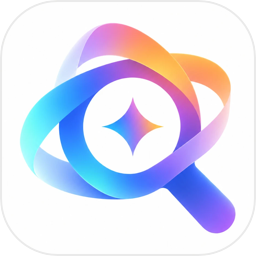

<p align="center">
  
</p>

<h1 align="center">Vibe Session Hub</h1>

<p align="center">
  <strong>跨多 AI 编程客户端的 PR 编号 / Git 分支 / 关键词秒搜 + 一键直跳历史会话 macOS 桌面中枢</strong><br/>
  <sub>Instant PR, branch &amp; keyword session search with native deep-link jump across Claude, Cursor, Codex, Gemini, Grok &amp; Antigravity.</sub>
</p>

<p align="center">
  
  
  
  
</p>

---

## 为什么做这个工具？

在多 Agent 并行推进 Vibe Coding 的日常工作流中，我们往往同时使用 **Claude Code / Desktop、Cursor、Codex、Antigravity、Gemini、Grok Bot** 等多个客户端，甚至分布在多台 Mac（如办公室 Mac Studio 与随身 MacBook Pro）和数十个 Git Worktree 中，每天高频提交大量 PR。

几天后当某个 PR 收到 Review 意见、线上回归问题或需要补充确认逻辑时，最耗时的一步往往是：**「这个 PR 当时是在哪个工具、哪台电脑、哪条历史会话里写的？」**

**Vibe Session Hub** 将所有客户端的本地会话自动增量汇聚成统一的毫秒级全文索引，让你直接输入 **PR 号**、**Git 分支** 或 **任意记忆碎片**，一键跳回当时的原始会话上下文继续追问。

---

## 核心特性

- **三级 PR 智能反查关联**
  1. **会话直提**：自动识别对话上下文与元数据中出现的 GitHub PR 链接及编号；
  2. **本地 Git 历史反查**：即使对话中从未提及 PR 号，输入 `5590` 或 `#6306` 时也会自动扫描本地仓库 `git log` 中带 `(#PR)` 的提交标题与变更文件列表，反向定位生成该提交的原始会话；
  3. **GitHub 远端分支按需反查**：对于网页端手动创建的 PR，支持一键拉取 PR 对应的源分支名回溯匹配本地会话。
- **原生客户端精准唤起**
  - 针对各桌面端定制原生 URL Scheme 深链；针对同源多实例客户端（如官方 **Claude Desktop** 与 **Claude Magpie** 同时运行），通过原生 Swift AppleEvent 工具 `send_url_to_pid` 将深链精准投递至目标进程 PID，互不抢占或误开窗口。
- **多台 Mac 零冲突自动同步**
  - 基于 iCloud Drive 按设备硬件 UUID 独立分片导出（`nodes/<machine_id>.jsonl`），多机并发写入零锁冲突，无需自建云端服务器。
  - 选中另一台 Mac 上的会话时，可一键复制跨机跳转链接（通过 Apple 通用剪贴板在目标电脑直接唤起），或点击 **「复制上下文摘要」** 将初始 Prompt、分支、PR 与进展摘要粘贴到当前电脑任意 Agent 无缝续接。
- **星环极光暗黑默认主题 + 9 款精选配色**
  - 默认采用与官方 Logo 极光星环光谱同源的 **「星环极光（Prism Aurora）」** 深邃暗黑配色，内置共 9 款深色/浅色护眼主题实时预览切换。
- **100% 本地优先与只读安全**
  - 零第三方 Python/Node 依赖，仅使用 macOS 系统自带 `python3`（SQLite FTS5）与 `swiftc`（AppKit + WebKit）；
  - 所有第三方客户端数据库均以只读模式（`mode=ro`）访问，绝不修改客户端原始数据；本地服务仅监听 `127.0.0.1:17380` 并强制校验同源请求头。

---

## 支持的客户端与直跳能力

| 客户端 | 自动采集内容 | 一键直跳方式 |
| :--- | :--- | :--- |
| **Claude Desktop / Claude Magpie** | 会话标题、初始提问、Git 分支、PR、状态摘要 | AppleEvent 精准直投对应进程 `claude://claude.ai/epitaxy/local_...` |
| **Cursor** | 本地 Composer/Agent、Background Agent、工作区与分支 | `cursor://anysphere.cursor-deeplink/agent?id=...` 及 `background-agent?bcId=...` |
| **Codex** | 会话记录、工作目录、Git 分支、关联 PR | `codex://threads/...` |
| **Gemini 桌面端** | 本地缓存对话与标题 | `googlegemini://conversation/c_...`（未装桌面端时自动回退网页） |
| **Grok Bot** | 本地 Agent 会话、工作区与分支 | `grokbot://app/v1/agent?id=...` |
| **Antigravity** | Brain / 会话目录、摘要文档与工作区路径 | 自动唤起对应工作区并在剪贴板填入会话标题快速定位 |
| **网页端（ChatGPT / Gemini / Grok 等）** | 支持在面板内手动绑定 PR 编号与会话 URL | 直接在默认浏览器打开对应会话链接 |

---

## 快速安装（macOS 13+）

### 方式一：下载 `.dmg` 安装包（推荐）

前往 [GitHub Releases](https://github.com/StriverF/vibe-session-hub/releases) 查看各版本更新内容并下载最新的 Universal 安装包（同时原生支持 Apple Silicon 与 Intel Mac）：

1. 下载 `Vibe-Session-Hub-vX.Y.Z-macos-universal.dmg` 并双击挂载；
2. 将 **`Vibe Session Hub.app`** 拖入右侧 **`Applications`** 文件夹；
3. 双击启动即可（应用已内置完整 Python 后端与前端资源，零第三方依赖）；
4. 如需关闭窗口后仍保持后台增量同步与跨机跳转服务运行，在菜单栏点击 **`Vibe Session Hub → 安装 / 更新开机后台服务`** 即可一键启用 LaunchAgent。

> 若首次启动时 macOS Gatekeeper 提示无法验证开发者（开源 Ad-hoc 签名构建），在终端执行一次即可放行：
> ```bash
> xattr -cr "/Applications/Vibe Session Hub.app"
> ```

### 方式二：从源码一键编译安装

本项目无需安装任何第三方依赖包，克隆仓库后一行命令即可完成原生 `.app` 编译与后台增量索引服务配置：

```bash
git clone https://github.com/StriverF/vibe-session-hub.git
cd vibe-session-hub
bash install.sh
```

执行 `install.sh` 会自动完成以下 4 步：
1. 调用 `scripts/package_macos.sh` 编译生成原生 macOS 应用 `../Vibe Session Hub.app`（自带高清圆角图标、`vibehub://` 协议与完整内置运行时，可直接拖入 `/Applications` 或固定到程序坞 Dock）；
2. 执行首次全量增量扫描，构建本地 SQLite FTS5 索引（`~/.vibe-session-hub/index.db`）；
3. 注册并启动后台常驻守护服务 `~/Library/LaunchAgents/com.vibesessionhub.app.plist`（默认监听 `http://127.0.0.1:17380`，支持通过 `VIBE_HUB_PORT` 自定义端口）；
4. 若当前 Mac 已开启 iCloud Drive，自动导出本机节点分片至 `~/Library/Mobile Documents/com~apple~CloudDocs/VibeSessionHub/`，并生成跨机便携安装脚本。

---

## 本地构建 DMG 与按版本自动发布（CI/CD）

- **本地打 Universal `.dmg` 包**：
  ```bash
  bash scripts/package_macos.sh --version 1.0.0 --arch universal
  ```
  产物将生成在 `dist/Vibe-Session-Hub-v1.0.0-macos-universal.dmg` 与 `.sha256` 校验文件。
- **自动 CI 验证**（`.github/workflows/ci.yml`）：每次 Push / Pull Request 到 `main` 时自动在 Linux（Python 3.12 & 3.13）和 macOS 15（系统 Python 3.9 + Swift Universal `.app` 构建 + 签名权限校验 + 自定义端口烟雾测试）执行零依赖测试套件。
- **按版本自动发布 Release**（`.github/workflows/release.yml`）：更新 `VERSION` 与 `CHANGELOG.md` 后推送版本标签即可自动跑测、构建 Universal `.dmg`、在只读挂载卷中做冒烟验证并发布至 [Releases](https://github.com/StriverF/vibe-session-hub/releases)：
  ```bash
  git tag -a v1.0.0 -m "Release v1.0.0"
  git push origin v1.0.0
  ```
  亦可在 GitHub Actions 页面手动触发 **`Release macOS DMG`** 工作流并填写版本号。
- **可选 Apple Developer ID 签名与公证**：在仓库 **Settings → Secrets and variables → Actions** 配置 `APPLE_SIGNING_CERT_P12`、`APPLE_SIGNING_CERT_PASSWORD`、`APPLE_SIGNING_IDENTITY`（及公证所需的 `APPLE_NOTARY_APPLE_ID`、`APPLE_NOTARY_PASSWORD`、`APPLE_TEAM_ID`）后，发布流程会自动启用 Hardened Runtime 由内向外签名 `.app` 与 `.dmg`、附带 `macos/entitlements.plist` AppleEvents 权限、执行 `notarytool` 公证与 `stapler` 装订，并通过 `spctl` Gatekeeper 校验。

---

## 多台 Mac 同步与一键配对

在登录同一 Apple ID 的第二台 Mac 上，既可以直接 `git clone` 仓库运行 `bash install.sh`，也可以直接执行已同步至 iCloud Drive 的便携安装脚本：

```bash
bash "$HOME/Library/Mobile Documents/com~apple~CloudDocs/VibeSessionHub/install-on-second-mac.sh"
```

- 点击界面左上角的设备名称胶囊（如 `MacBook Pro (本机)`），可随时自定义当前电脑的易读显示名；
- 顶栏筛选条支持按 **设备**、**Agent 工具** 及 **仅看含 PR** 一键过滤。

---

## 快捷键与检索技巧

| 操作 / 输入示例 | 说明 |
| :--- | :--- |
| `⌘K` | 随时聚焦顶部搜索框 |
| `↑` / `↓` | 在左侧会话结果列表中上下移动焦点，右侧实时预览完整上下文 |
| `↵`（回车） | **本机**会话：直接唤起对应客户端进入该会话；**跨设备**会话：复制跨机打开链接 |
| `Esc` | 清空当前搜索词或关闭弹窗面板 |
| 输入 `6306` / `#6306` / `owner/repo#6306` | 触发 PR 专项检索 + 本地 Git 提交历史自动反查，支持一键联网拉取 GitHub PR 分支 |
| 输入分支名或关键词（如 `feat/billing`、`meta-ads`） | 通过全文索引匹配标题、首条提问、最新摘要、分支名及项目路径，并高亮命中片段 |

---

## 目录结构与数据说明

```text
vibe-session-hub/
├── .github/
│   ├── release.yml            # GitHub Release 自动分类规则
│   └── workflows/
│       ├── ci.yml             # Linux + macOS 零依赖测试与 Universal App 构建校验
│       └── release.yml        # vX.Y.Z 标签驱动：全量验测、构建 .dmg 并发布 GitHub Releases
├── hub/
│   ├── collectors/            # 模块化只读采集器插件包（base / claude / codex / cursor / gemini / grok_bot / antigravity）
│   ├── config.py              # 端口解析透传、HubPaths 依赖注入容器、机器硬件指纹、日志与主题偏好管理
│   ├── tool_registry.py       # 全栈工具元数据单一事实源（标签、图标、Bundle ID、深链协议、手动登记选项）
│   ├── sync_mirror.py         # 跨进程 flock 锁、内容哈希原子写入与单向所有权 iCloud 分片镜像
│   ├── shard_ingestor.py      # JSONL 分片解析、手动 PR 链接合并与按行 SHA-256 增量入库引擎
│   ├── search_engine.py       # SQLite FTS5 trigram 全文检索、PR singleflight 反查与 Facets 聚合
│   ├── storage.py             # WAL 数据库连接/Schema 管理与存储协调门面（SessionHubStore）
│   ├── git_pr_resolver.py     # 本地 git log 提交历史与 gh CLI 远端 PR 分支反查器
│   ├── launcher.py            # 基于工具注册表与策略分发表的原生 Deep-Link 安全唤起逻辑
│   ├── updater.py             # GitHub Releases 版本检查、校验规则与 CHANGELOG 解析器（浏览器模式回退）
│   └── server.py              # 本地 HTTP API、加固静态 ES 模块服务与后台定时增量同步守护线程
├── macos/
│   ├── VibeSessionHub.swift   # 原生 macOS AppKit + WKWebView 桌面容器、自动升级旧后台服务与独立运行支持
│   ├── AppUpdater.swift       # 原生应用内版本检查、DMG 下载校验、安全静默替换与重启更新引擎
│   ├── BackendUpgradeLogic.swift # 后端版本/路径/构建标识校验、发布源解析与 LaunchAgent 自动升级决策模块
│   ├── build_icon.swift       # 自动生成全尺寸 macOS AppIcon.icns 与高清图标
│   ├── entitlements.plist     # Hardened Runtime 最小权限集（AppleEvents 精准投递深链）
│   └── send_url_to_pid.swift  # 按指定进程 PID 精准投递 AppleEvent GURL 深链
├── scripts/
│   ├── package_macos.sh       # 独立 .app 打包与 Universal macOS .dmg + SHA-256 生成脚本
│   └── extract_release_notes.py # 从 CHANGELOG.md 提取版本说明并拼接安装指引与校验和
├── static/
│   ├── index.html             # 搜索工作台与主题/PR 绑定交互界面
│   ├── styles.css             # 星环极光默认暗黑配色及全部 9 套主题样式表
│   ├── js/                    # 原生无构建 ES 模块（state / api / utils / theme / render / main）
│   └── icons/                 # 官方应用 Logo 与各 Agent 工具高清图标
├── tests/
│   ├── fixtures/              # 全部 7 个客户端的纯文本脱敏采集 Fixture
│   ├── test_p0_optimizations.py
│   ├── test_p1_architecture.py
│   └── test_p2_collectors_and_security.py
├── VERSION                    # 版本号单一事实源
├── CHANGELOG.md               # 版本变更日志（自动同步至 GitHub Release 说明）
└── install.sh                 # 源码一键编译、LaunchAgent 注册与 iCloud 同步配置脚本
```

### 运行时本地路径与服务管理

- **本地状态与缓存目录**：`~/.vibe-session-hub/`（包含 `index.db`、`machine.json`、`preferences.json` 及服务日志，不进入 Git 仓库）
- **iCloud 同步分片目录**：`~/Library/Mobile Documents/com~apple~CloudDocs/VibeSessionHub/`（可通过环境变量 `VIBE_HUB_LOCAL_ONLY=1` 关闭 iCloud 同步，或通过 `VIBE_HUB_PORT` 自定义端口）
- **重启 / 停止后台守护服务**：

```bash
launchctl kickstart -k "gui/$(id -u)/com.vibesessionhub.app"
```

```bash
launchctl bootout "gui/$(id -u)" "$HOME/Library/LaunchAgents/com.vibesessionhub.app.plist"
```
